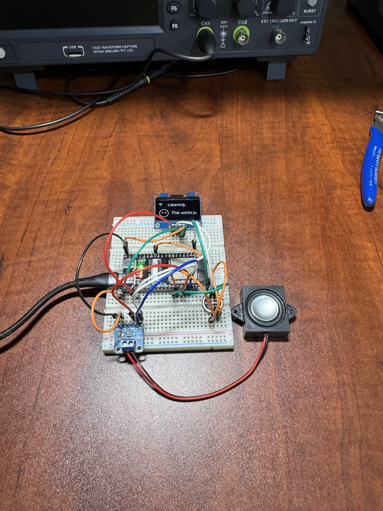
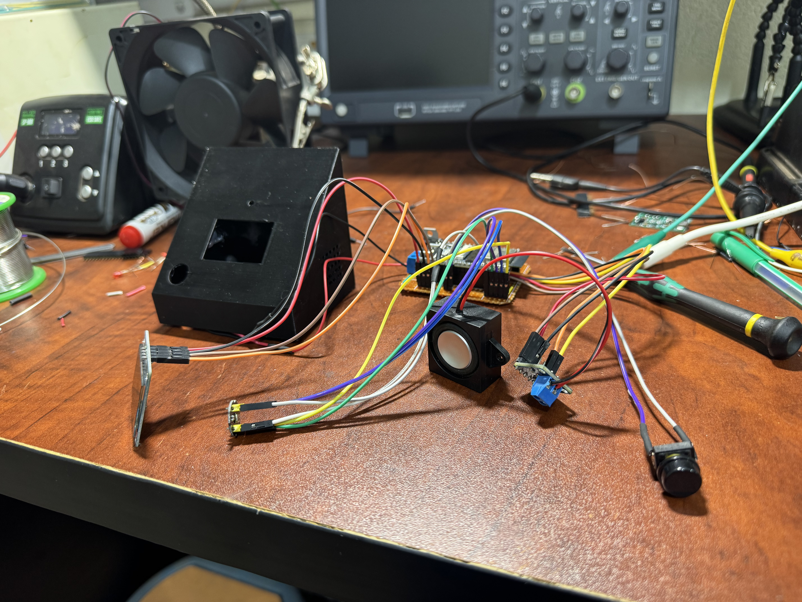
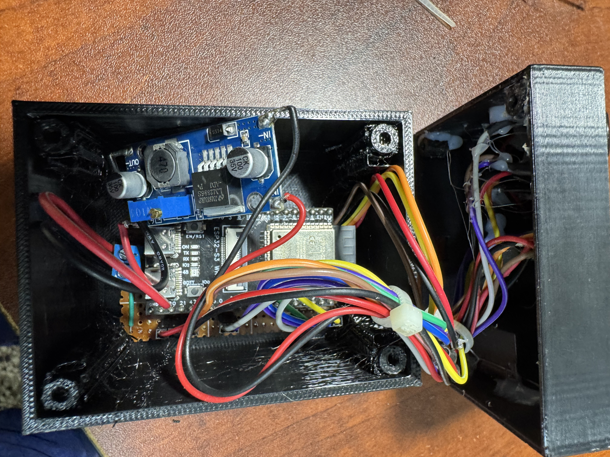

# XiaoZhi ESP32-S3 Custom Voice Assistant


This repository contains **[mpuugaAbdu's](https://github.com/mpuugaAbdu) customized hardware build** of the XiaoZhi AI voice-assistant firmware. It is designed for an ESP32-S3-N16R8 development board with an INMP441 digital microphone, MAX98357A I2S amplifier, and SH1106 128x64 OLED.

Watch the build and demonstration on YouTube: **[ESP32-S3 XiaoZhi custom build video](https://youtu.be/1Zp9yaNudxU?si=q4IwySt1AM3lGgIJ)**

## Hardware

- ESP32-S3-N16R8 development board
- INMP441 I2S microphone
- MAX98357A I2S class-D amplifier
- SH1106 128x64 I2C OLED
- Passive speaker suitable for the MAX98357A module
- Breadboard and jumper wires for prototyping
- Common ground and a suitable power supply

## Pin configuration

### INMP441 microphone

| INMP441 signal | ESP32-S3 pin | Firmware symbol |
|---|---:|---|
| WS | GPIO 41 | `AUDIO_I2S_MIC_GPIO_WS` |
| SCK | GPIO 3 | `AUDIO_I2S_MIC_GPIO_SCK` |
| SD | GPIO 40 | `AUDIO_I2S_MIC_GPIO_DIN` |
| VDD | 3.3 V | Power |
| GND | GND | Common ground |

### MAX98357A amplifier

| MAX98357A signal | ESP32-S3 pin | Firmware symbol |
|---|---:|---|
| DIN | GPIO 42 | `AUDIO_I2S_SPK_GPIO_DOUT` |
| BCLK | GPIO 1 | `AUDIO_I2S_SPK_GPIO_BCLK` |
| LRC/LRCLK | GPIO 2 | `AUDIO_I2S_SPK_GPIO_LRCK` |
| GND | GND | Common ground |

Connect the speaker only to the amplifier's `SPK+` and `SPK-` outputs. Do not connect either speaker output to ground. Power the amplifier according to the voltage range printed on your specific breakout board.

### SH1106 OLED

| OLED signal | ESP32-S3 pin | Firmware symbol |
|---|---:|---|
| SDA | GPIO 21 | `DISPLAY_SDA_PIN` |
| SCL | GPIO 47 | `DISPLAY_SCL_PIN` |
| VCC | 3.3 V | Power |
| GND | GND | Common ground |

The firmware is configured for a 128x64 SH1106 display. Many modules use I2C address `0x3C`, but verify the address printed by your module supplier or detected by an I2C scan.

For photographs, assembly order, wiring notes, and safety checks, see the **[illustrated hardware setup guide](output/pdf/esp32-s3-xiaozhi-hardware-setup.pdf)**.

## Build progression

| Breadboard prototype | Soldered assembly |
|---|---|
|  |  |

Prototype and test every peripheral before transferring the circuit into the enclosure. The final assembly photo below shows the controller, wiring, display, and enclosure arrangement used for this customized build.



## Building the firmware

Use **ESP-IDF v6.1** when possible. The minimum supported version is ESP-IDF v6.0.1; ESP-IDF 5.x is not supported.

```sh
source /path/to/esp-idf/export.sh
idf.py --version
python3 scripts/build.py bread-compact-wifi --name bread-compact-wifi-sh1106-128x64
```

The build command regenerates local `sdkconfig`, downloaded managed components, and the `build` directory. These generated files are intentionally excluded from version control.

Before powering the assembled unit:

1. Disconnect USB and external power while changing wiring.
2. Confirm all modules share ground.
3. Check for shorts between power and ground with a multimeter.
4. Confirm the microphone and OLED receive 3.3 V logic.
5. Keep the INMP441 away from the speaker and amplifier wiring to reduce feedback and noise.
6. Test microphone capture, OLED output, and speaker playback separately before closing the enclosure.

## Project origin and modifications

This is a customized derivative of the XiaoZhi ESP32 project. The original work is credited in the repository's [MIT License](LICENSE):

- Copyright (c) 2025 Shenzhen Xinzhi Future Technology Co., Ltd.
- Copyright (c) 2025 Project Contributors

Hardware selection, pin configuration, assembly, documentation, and build customization in this repository were prepared by **[mpuugaAbdu](https://github.com/mpuugaAbdu)**. This statement describes the modifications and does not replace or remove the original authors' copyright.

## License

This project remains available under the [MIT License](LICENSE). Retain the license and copyright notice when copying, modifying, or redistributing substantial portions of the software.
